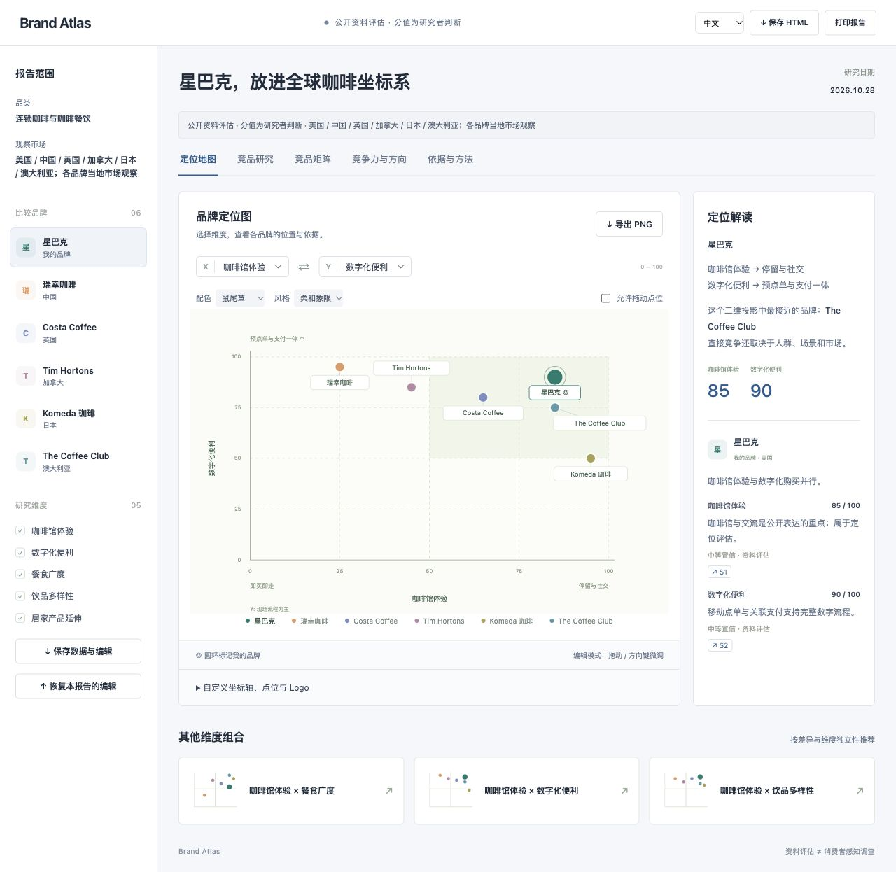

# Brand Atlas · 品牌定位研究 Skill

**从品牌、特点或经典产品发现全球竞品，生成中英双语定位报告，亲手编辑地图，导出图片。**



一个可放进 GitHub 仓库、安装到 AI 助手中的 Agent Skill。联网研究由宿主助手执行，Python 标准库生成独立 HTML；不需要前端构建或额外模型密钥。可选的本地工作台可把网页需求交给当前助手，或通过 DeepSeek / Gemini 自动检索。

[打开星巴克示例](examples/demo.html) · [研究数据](examples/demo.json) · [数据规范](references/report-schema.md)

## 运行 Brand Atlas

安装后说 **“运行 Brand Atlas”**，助手会打开分项问卷，品牌与市场分别填写，竞品数量和研究深度等可以直接选择。宿主不支持问卷时，提供表格或文字填写。已提供的信息会预填；如果你的指令已经完整，助手会直接开始。

| 项目 | 填写要求 / 默认值 |
|---|---|
| 品牌 / 具体产品 | 需明确；也可以提供品牌特点或经典产品线索 |
| 目标市场国家 / 地区 | 需明确；支持多国或“全球代表市场” |
| 竞品数量 | 默认 3 个，不含自己的品牌；默认是跨市场总数，可改为每国数量 |
| 指定竞品 | 可选；未填由助手筛选，指定品牌计入数量 |
| 希望对比的维度 | 默认推荐 4 个；可直接指定横轴、纵轴和其他维度 |
| 目标客群 / 研究目的 | 可选；帮助判断哪些竞品有可比性 |
| 官网 / 产品链接 / 特点 | 可选；减少同名误认和反复检索 |
| 研究深度 | 快速首版（默认） / 深入研究 |

**快速首版**集中完成所选品牌和维度的公开资料评估；**深入研究**在相同范围内增加交叉验证、反证和市场细节。二者都保留完整的中英切换、地图编辑、点位拖动、Logo、配色和 PNG 导出。研究深度不会擅自增加竞品或覆盖你指定的维度。

选定的维度一次研究完，之后换轴直接显示；新增维度或竞品时只补充相关研究。填写后的范围保存在报告旁的 `brief.md`，后续“继续”或“执行研究”会沿用它。预设减少来回确认和重复工作，实际耗时仍取决于范围、资料和工具速度，不承诺固定时间，也不要求 API Key。具体规则见 [启动问卷与预设](references/intake.md)。

## 新版能力

| 能力 | 使用方式 |
|---|---|
| 启动问卷 | 说“运行 Brand Atlas”，一次提供品牌、目标市场、竞品数量和维度；默认快速首版 |
| 中英内容切换 | 界面、正文、评分理由、维度、策略、来源说明都可切换；事实和数值保持一致 |
| 自定义定位地图 | 切换或交换轴；修改轴名与两端；添加新维度，最多 12 个 |
| 自由移动点位 | 打开“允许拖动点位”；鼠标/触控拖动、方向键微调或输入 0–100 坐标 |
| 品牌 Logo | 选择品牌后上传 PNG/JPG/WebP，最多 5 MB；本机处理，随 PNG/HTML 导出 |
| 全球竞品发现 | 网页提交品牌、特点或产品线索；当前助手或已配置的 DeepSeek / Gemini 联网研究，完成后自动更新报告 |
| 竞争力与改善 | 各品牌优势、改善假设、可验证行动、逐维度依据与置信度 |
| 地图视觉 | 蓝白商务界面；可展开报告范围；4 套配色、3 种地图风格、独立点位颜色 |
| 保存与分享 | 2400 × 1600 PNG；保存完整 HTML 和 JSON，保留语言、Logo、点位与样式 |

**原始研究与手动情景分开保存。** 拖动不会改写研究依据；新维度不会自动获得虚构分数；缺少分值的品牌会列出，但不放到图中。分析页保留原始研究结论。自定义标签保留输入原文，不会自动翻译。

## 先体验星巴克 sample

浏览器打开 [`examples/demo.html`](examples/demo.html)。以星巴克为自己的品牌，比较瑞幸、Costa Coffee、Tim Hortons、Komeda、The Coffee Club，分别观察美国、中国、英国、加拿大、日本、澳大利亚。

样本基于 **2026-10-28 检索的 19 个官方来源或官方应用页面**，分数是研究者的粗略资料评估，**不是消费者调查或品牌官方排名**。来源部分包含历史资料与搜索摘录，报告注明了限制。国家表示观察市场；跨国模式参考不能直接当作同城竞争。没有虚构引用或把未查到的能力打成 0 分。

建议体验顺序：

1. 切换 English，查看英文内容与地图。
2. “竞品研究”输入品牌、产品或特点；“筛选已有品牌”用于本地筛选，“提交竞品研究”交给当前助手。
3. 在地图打开编辑面板，增加维度、填写坐标、上传自己的 Logo。
4. 选择配色和风格，导出 PNG，保存 HTML。

刷新会恢复上次保存版本。**保存 HTML 是保留编辑的方式**；没有隐式上传或浏览器自动保存。JSON 可恢复同一份原始研究的编辑；新研究 JSON 请用生成器渲染。

## 安装与调用

将整个目录命名为 `brand-positioning`，放到助手的 Skill 目录，重新加载技能列表。不要只复制 `SKILL.md`。

| 宿主 | 用户级目录 |
|---|---|
| Codex | `~/.codex/skills/brand-positioning/` |
| Claude Code | `~/.claude/skills/brand-positioning/` |
| 其他 Agent Skills 宿主 | 使用该助手规定的目录 |

需要文件读取/执行、Python 3.9+，以及真实研究所需的联网工具。默认研究使用宿主工具；可选的 DeepSeek / Gemini 模式使用你在本机配置的提供商账号，调用费用与权限由该账号承担。并非所有纯聊天界面都支持运行脚本。

从问卷开始：

```text
使用 $brand-positioning，运行 Brand Atlas。
```

或一次给齐研究要求：

```text
使用 $brand-positioning。
我想研究星巴克。请发现中国、日本、澳大利亚的代表竞品，区分当地直接竞品和战略参考。
比较咖啡馆体验、数字便利、餐食广度、饮品多样性。
生成中英可切换的报告，包含可拖动的定位图、竞品矩阵、各品牌竞争优势和改善方向。
保留逐分来源，支持自定义轴、Logo、配色、PNG 导出。
```

也可以从产品或特点开始：

```text
使用 $brand-positioning。我的线索是“低糖、植物基、面向通勤者的即饮咖啡”。
帮我发现英国、美国和日本的竞品，以及解决同一消费需求的替代品。
说明入选原因，找不到的证据留空，生成中英双语报告和可验证的改善建议。
```

## 网页研究与 API 设置

```bash
python3 scripts/serve_report.py /path/to/report.json --port 8765
```

本地工作台适用于 macOS / Linux，打开终端输出的地址。页面右上角的 **研究设置** 提供三个入口：

| 模式 | 使用方式 |
|---|---|
| 当前助手（默认） | 无需额外密钥。网页提交轴或竞品需求后，在当前对话说“执行研究”，助手检索完成后页面更新 |
| DeepSeek | 填写 API Key 和模型；通过 DeepSeek 搜索接口检索资料，再生成更新结果 |
| Gemini | 填写 API Key 和模型；通过 Google 搜索 Grounding 检索，并保留来源和搜索归属信息 |

API 模式配置后，网页提交即可自动开始研究。保存设置只保存配置，不会调用付费接口，也不代表密钥已验证。**密钥仅保存在本地服务内存中**，重启需重新填写；也可通过 `DEEPSEEK_API_KEY` / `GEMINI_API_KEY` 环境变量提供。支持修改模型和清除密钥。不要把密钥发到聊天、提交到 GitHub 或写进报告。

API 研究会把品牌、市场、相关原始研究和本次请求发送给选定提供商；不发送上传 Logo 或手动点位。失败、缺少搜索依据或取消的任务不会覆盖原报告。已发出的调用可能仍产生提供商费用。真实可用性取决于账号、模型与搜索权限。

普通 HTML 无法自行唤醒聊天助手；默认模式提交后显示等待助手执行。导出的 HTML 仍可离线编辑与导出 PNG；GitHub Pages 只能展示报告，API 设置与自动研究需要运行本地服务。详见 [助手研究流程](references/live-research.md) 与 [API 配置和实现](references/api-research.md)。

## 生成与更新

```bash
python3 scripts/validate_report.py examples/demo.json
python3 scripts/render_report.py examples/demo.json --out examples/demo.html --force
# 自己的数据：
python3 scripts/render_report.py /path/to/report.json --out /path/to/report.html
```

输入格式见 [数据规范](references/report-schema.md)。渲染器先校验，再输出 HTML 与 Markdown。默认不覆盖旧文件，`--force` 显式覆盖。HTML 中的语言切换依赖生成时提供的完整英文内容，而不是浏览器机器翻译。

## 研究口径

- 高分不一定更好；不把不同轴加总为未经解释的“品牌竞争力”。
- 官网主张不等于用户感知、实际执行或经济表现。
- 同规格、同市场、同日期的量化比较才可直接解释差距。
- 跨国比较需注明观察市场；“未找到”不等于“不存在”。
- 验证器检查格式、分数与引用，不能证明证据支持推断，仍需研究者判断。

## 目录与开发

```text
SKILL.md                    # 研究、发现、编辑的工作流程
agents/openai.yaml          # Skill 展示元数据
references/                 # 研究规范、发现方法、数据协议
scripts/                    # 零依赖 Python 校验与生成
assets/                     # HTML/CSS/JS 交互模板
examples/                   # 星巴克双语示例、数据、PNG 和截图
tests/                      # 有效性、语言、情景、搜索、投影测试
.github/workflows/          # GitHub 自动检查
```

```bash
python3 -m unittest discover -s tests -v
node --test tests/report_math.test.cjs
node --check assets/report.js
```

自动检查覆盖报告结构、双语、投影、场景、研究队列、API 适配器、密钥不落盘、来源校验和失败保留。API 自动测试使用模拟响应，不代表付费账号已通过真实调用验证。浏览器检查包含中文标签在重绘后保留、提交与取消研究、研究结果自动回填、双语和导出。

Node.js 18+ 仅用于 JavaScript 测试，正常生成不需要。页面没有 CDN、外部字体或跟踪服务；浏览器只向本地工作台提交配置和请求；可选 API 模式由工作台访问提供商官方接口。Logo 从文件上传后在本机缩放到 256px 并嵌入；外部来源只在主动点击时打开。

## GitHub 与许可

本目录就是可上传的仓库根目录。保留相对路径即可；`examples/demo.html` 可选用 GitHub Pages 展示。点击 GitHub 的 Code → Download ZIP 即可下载，解压后按安装说明放入 Skill 目录。安装不自动发布网站或配置 API。

原创实现，采用 [MIT](LICENSE)。研究和交互思路参考了 [Vantage](https://github.com/macmenes/vantage) 和 [Brand Positioning Map](https://github.com/HeroQ67/brand-positioning-map)，未复制它们的代码或提示词。示例提及的品牌、产品名及用户上传 Logo 属于各自权利人；MIT 适用于本项目原创代码与模板，不赋予第三方商标权利。
